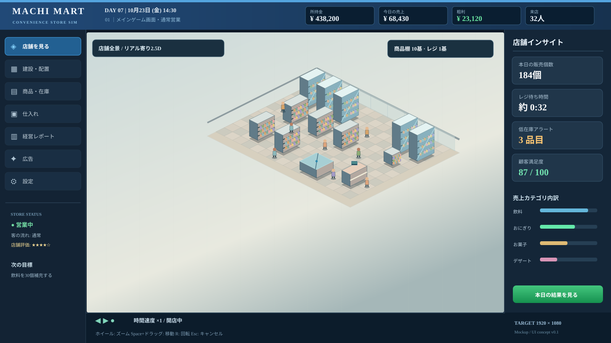
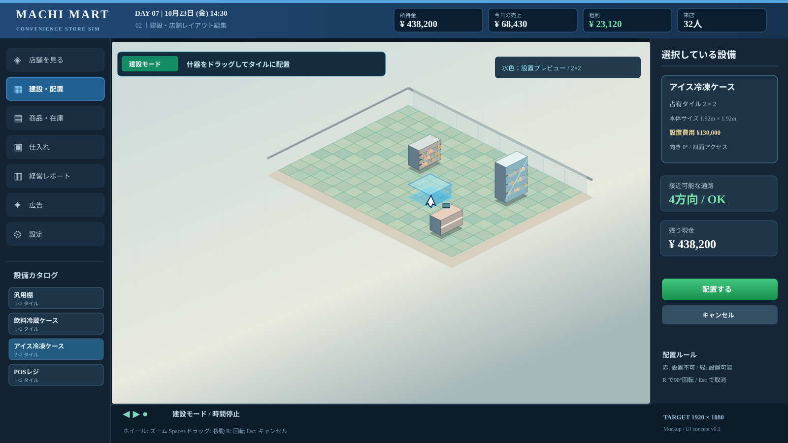
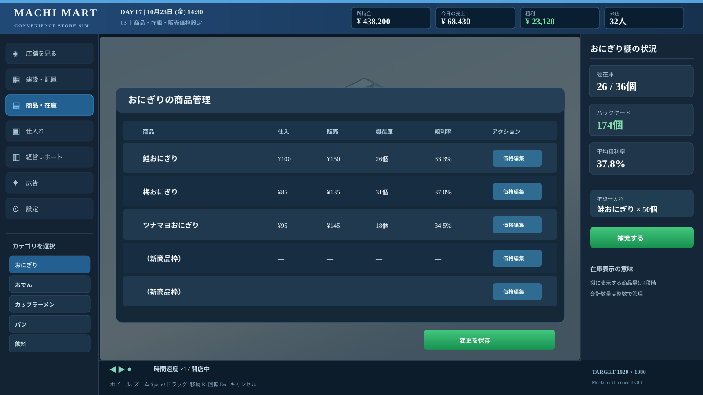
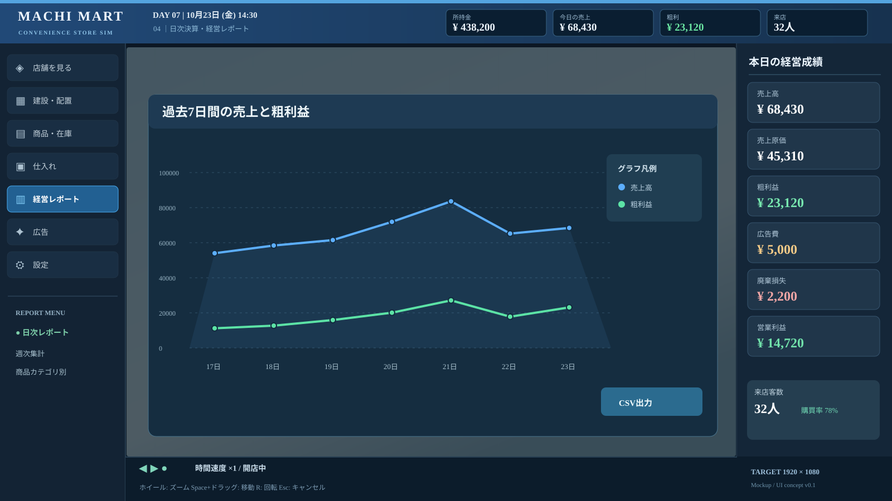

# Convenience_store_Sim

リアル寄りの **2.5Dアイソメトリック・コンビニ経営シミュレーション**（企画・設計段階）。

店舗の棚・レジ・冷蔵ケースなどをタイル単位で配置し、8カテゴリの商品を仕入れ・陳列。顧客行動、レジ会計、粗利・廃棄・広告費の収支を改善しながら経営する。

## 状態
- **仕様書・GitHub Issue登録済み、ゲーム本体は未実装**。
- 初期技術方針: Godot 4 / GDScript / Blender Python → PNG透明スプライト。
- ローカル開発・テスト中心（GitHub Actionsは使用しない）。

## 設計文書
1. [全体ゲーム仕様](docs/GAME_DESIGN_SPEC.md)
2. [2.5Dアセット制作規格](docs/ASSET_PRODUCTION_SPEC.md)
3. [什器10種・初期24SKU制作カタログ](docs/ASSET_CATALOG.md)
4. [顧客・在庫・経営シミュレーション規約](docs/SIMULATION_ECONOMY_SPEC.md)
5. [ゲーム進行・操作UI・初回導線](docs/GAMEPLAY_UX_SPEC.md)
6. [受入・テスト計画](docs/QA_ACCEPTANCE_PLAN.md)
7. [素材出典台帳](docs/ASSET_CREDITS.md)
8. [レビュー指摘と対応記録](docs/SPEC_REVIEW_2026-10-22.md)
9. [Issue連動実装タスクリスト](docs/IMPLEMENTATION_TASKS.md)

## GitHub管理
- [親Issue #1 — MVP全体計画](https://github.com/yn217/Convenience_store_Sim/issues/1)
- [全Issue](https://github.com/yn217/Convenience_store_Sim/issues)
- 実装作業は基盤→店舗配置→商品/在庫→客/会計→広告/経営→QAの依存関係で進行。

## 最初の開発ステップ
1. Godotプロジェクトとheadlessテスト基盤。
2. 16×12直交グリッドを2:1菱形に投影。
3. 1×2什器の配置/回転、レジ未設置でも建設できる状態を実装。
4. Blenderからレジ/棚/飲料ケースの4方向スプライトを自動生成。
5. 商品を仕入れ、補充し、客が会計して日次決算まで動く縦断スライスを構築。

現時点で動くゲームや実画像アセットは含まれません。


## 実装詳細規約（2026-10-22に追加）

**MVP実装時の正本:** [実装ベースライン](docs/implementation/00_BASELINE_AND_DECISIONS.md)。概念仕様だけで実装せず、次の契約書・JSON Schemaを参照する。

1. [00 — 仕様の優先順位、ゲーム定数、MVP凍結事項](docs/implementation/00_BASELINE_AND_DECISIONS.md)
2. [01 — Godotディレクトリ・scene・クラス/API契約](docs/implementation/01_ENGINE_CONTRACT.md)
3. [02 — タイル/アセットの物理寸法、投影、回転・anchor](docs/implementation/02_GRID_AND_ASSET_CONTRACT.md)
4. [03 — 在庫、客AI、会計、広告、日次の確定アルゴリズム](docs/implementation/03_ECONOMY_AND_SIMULATION_CONTRACT.md)
5. [04 — UI、セーブ/ロード、テスト・性能の実装契約](docs/implementation/04_UI_SAVE_QA_CONTRACT.md)
6. [05 — Codex/Claude向け担当レーン・作業順・完了条件](docs/implementation/05_IMPLEMENTATION_HANDOFF.md)
7. [06 — Blender什器Blueprint、商品サイズ、製造・検査手順](docs/implementation/06_ASSET_BLUEPRINTS_AND_VALIDATION.md)
8. [JSON Schema 5種](docs/schemas/) / [サンプルと初期マスタ（什器10種・商品24SKU）](docs/examples/README.md)

**縮尺の規格:** 1tile=1m、表示128×64px/tile、source=256×128px/tile、Blender共通正投影45°方位・30°仰角、1×2什器は2mの長辺Eを客側とする。PNGのキャンバスを無理に同じ幅/高さへ揃えない。

**注意:** 規則/JSON/例の静的整合性のレビューは済んでいるが、ゲームコード・什器メッシュ・画像アセットの制作および実機検証はまだ行っていない。

- [07 — 実装着手判定と残存検証ゲート](docs/implementation/07_SPEC_REVIEW_READINESS.md)


### 2026-10-23 最終実装契約
- [08 営業状態・一時停止・コマンド実行](docs/implementation/08_RUNTIME_STATE_AND_COMMANDS.md)
- [09 固定乱数・顧客/経営・安全セーブ](docs/implementation/09_DETERMINISTIC_SIMULATION_AND_SAVE.md)
- [10 数値ゴールデンテスト](docs/implementation/10_TEST_VECTORS_AND_ACCEPTANCE.md)

**初期開発エンジン:** Godot 4.7.2-stable。実装仕様は上述の追加契約を含む。実機でのBlender画角・PNG接地・性能・プレイ検証は未着手。


- [11 2026-10-23 仕様最終レビューと修正記録](docs/implementation/11_REVIEW_2026_10_23.md)


## 2026-10-23 補完レビュー（実装の関数別契約）
- [12 実装疑似コード・各関数の入力/出力/副作用](docs/implementation/12_REFERENCE_ALGORITHMS_AND_API.md)
- [08 営業状態/命令/費用不足](docs/implementation/08_RUNTIME_STATE_AND_COMMANDS.md)
- [09 乱数・価格・新日費用・保存](docs/implementation/09_DETERMINISTIC_SIMULATION_AND_SAVE.md)
- 明示的なOPEN→CLOSING→SETUPを通らず、時計停止のみで棚を移動しない。レジのない空店舗への棚設置は可。


## ゲーム画面モックアップ（2026-10-23）

リアル寄り2.5Dアイソメトリックのプレイ画面を**4枚のSVG画像としてGit登録**しました。画面の質感・UI構成の基準です。ゲームコード/実3Dアセットを作ったという意味ではありません。

| 通常営業 | 建設・配置 |
|---|---|
|  |  |
| [SVGを開く](docs/design/mockups/01_store_overview.svg) | [SVGを開く](docs/design/mockups/02_layout_editor.svg) |

| 商品・在庫管理 | 日次決算 |
|---|---|
|  |  |
| [SVGを開く](docs/design/mockups/03_inventory_management.svg) | [SVGを開く](docs/design/mockups/04_daily_report.svg) |

- [4画面の役割・仕様と注意点](docs/design/mockups/README.md)
- [Godot/Blender/コード/テストのディレクトリ構造](docs/design/PROJECT_DIRECTORY_STRUCTURE.md)
- [UIデザイントークン・イベント伝播ルール](docs/design/UI_DESIGN_TOKENS.md)
- **制作規格は別**: [1tile=1m / 128×64px / source2倍 / 正投影角度](docs/implementation/02_GRID_AND_ASSET_CONTRACT.md)。モックアップのSVG内タイルは説明用縮尺。


## ゲーム演出・イベント・成長目標（仕様追加 2026-10-23）

**設計書・初期データをGitHub登録済み**。ゲームが動作する実装や効果音/スプライトが完成したことを意味しません。

- [日替わりイベント12種 / EventDirector](docs/implementation/13_EVENT_DIRECTOR_AND_GAMEPLAY_EVENTS.md)
- [入店・会計・売切れなどの演出15種、音/VFX仕様](docs/implementation/14_ANIMATION_AUDIO_VFX_CONTRACT.md)
- [初日チュートリアル・実績12種・日替わり目標3種](docs/implementation/15_PROGRESSION_STORY_AND_SCENARIOS.md)
- [固定シード・アニメ・UI・保存の24受入テスト](docs/implementation/16_EVENT_QA_AND_ASSET_CHECKLIST.md)
- [ゲームイベントJSON](docs/examples/mvp_v1.gameplay_events.json)、[Cue JSON](docs/examples/mvp_v1.presentation_cues.json)、[実績JSON](docs/examples/mvp_v1.milestones.json)
- 子Issue: [#30 演出](https://github.com/yn217/Convenience_store_Sim/issues/30)、[#31 イベント](https://github.com/yn217/Convenience_store_Sim/issues/31)、[#32 成長目標](https://github.com/yn217/Convenience_store_Sim/issues/32)

イベントの経済効果は来店需要と対象商品カテゴリの人気度に限定し、**描画/SFX側で現金や在庫を直接書き換えません**。

## ゲーム画面18枚のモックアップと画面実装仕様（2026-10-23）

**追加14枚のSVGをGit登録**し、既存4枚と合計18画面になりました。

- [全18画面のプレビューと個別SVG画像](docs/design/mockups/README.md)
- [画面ごとの実装詳細仕様（18画面）](docs/design/SCREEN_SPECIFICATIONS_V1.md)
- [画面遷移・操作可能状態・エラーとモーダル入力の規則](docs/design/SCREEN_NAVIGATION_AND_STATE_MATRIX.md)

新規SVG: [タイトル](docs/design/mockups/05_title_new_game.svg) / [チュートリアル](docs/design/mockups/06_first_day_tutorial.svg) / [発注](docs/design/mockups/07_purchase_order.svg) / [補充](docs/design/mockups/08_shelf_restock.svg) / [開店](docs/design/mockups/09_opening_checklist.svg) / [閉店](docs/design/mockups/10_closing_in_progress.svg) / [イベント](docs/design/mockups/11_daily_event_festival.svg) / [初売上](docs/design/mockups/12_first_sale_achievement.svg) / [日次まとめ](docs/design/mockups/13_day_end_summary.svg) / [支払不能](docs/design/mockups/14_payment_blocked.svg) / [店舗分析](docs/design/mockups/15_store_heatmap.svg) / [セーブ](docs/design/mockups/16_save_load_settings.svg) / [広告](docs/design/mockups/17_next_day_advertising.svg) / [実績](docs/design/mockups/18_milestones_and_challenges.svg)。

**注意:** SVGは構図/画面遷移の参考画像。実際の透過PNG/Blenderアセットや動作するGodotのゲームは制作中ではなく未実装。数値/経済/回転は`docs/implementation`の正式契約が優先します。


## 開発手順（M0-01 / Windows）
1. Godot **4.7.2-stable**（標準版）を用意する。`$env:GODOT` に `Godot_v4.7.2-stable_win64_console.exe` を指定するか、リポジトリの親フォルダの `_tools\godot-4.7.2\` に置く。
2. 起動: `Godot_v4.7.2-stable_win64.exe --path .`（空店舗 16×12、SETUP、一時停止状態で開く）。
3. 検証一式（依存方向チェック、GDScript構文検査、headlessテスト）:
   ```powershell
   .\tools\run_tests.ps1
   ```
4. headlessテストだけ: `godot --headless --path . --script res://tests/run_all.gd`（終了コード0=成功）。
- テストの乱数seedは `tests/support/test_seeds.gd`（arrivals=1234, purchases=5678, visuals=9012）に固定。
- 依存方向は [docs/design/PROJECT_DIRECTORY_STRUCTURE.md](docs/design/PROJECT_DIRECTORY_STRUCTURE.md) を参照。GitHub Actionsは使わない。
