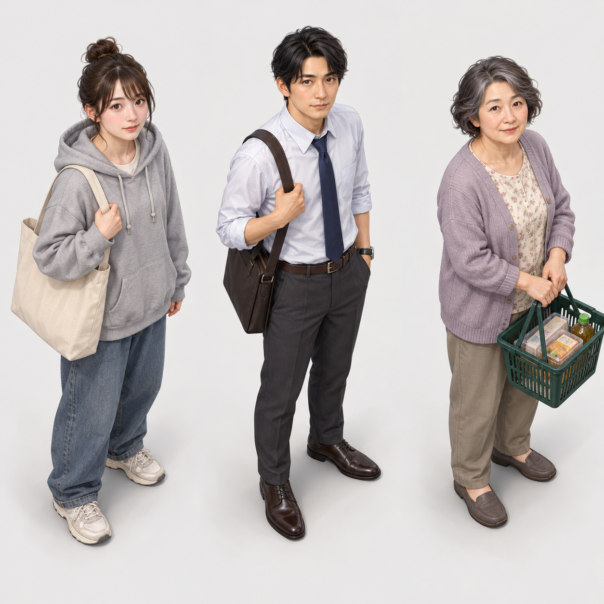

# Customer art candidates (Issue #23)

This board is a source-art candidate for the customer sprite work in Issue #23. It contains three fictional adult variants: casual hoodie and tote, office worker with shoulder bag, and older adult with cardigan and basket.

The equal-third crops are reproducible with `tools/art/split_customer_candidates.py` and are listed in `assets/source/textures/characters/CANDIDATE_CROPS.json`.

Transparent cutout pilots are stored at `assets/source/textures/characters/candidates/customer_casual_tote_cutout_v01.png`, `customer_office_shoulder_bag_cutout_v01.png`, and `customer_older_basket_cutout_v01.png` (all 1024x1536 RGBA). They are source-art pilots, not production sprites: scale, anchor, shadow, and direction consistency still require review.

## Issue #23 conversion gate

- [x] Three fictional customer variants have source candidates and transparent cutout pilots.
- [ ] Generate directions 0, 1, 2, 3 from one common camera/model; do not use simple mirroring.
- [ ] Adopt `projection_id="iso2x_v1"`, 1m tile scale, and common foot anchor.
- [ ] Record `canvas_px`, `anchor_px`, and `sorting_anchor_px` in a manifest.
- [ ] Produce walk 6 frames, idle 2 frames, inspect 4 frames, checkout 4 frames, and exit 2 frames per direction.
- [ ] Validate zoom 0.5/1/2 and front/back occlusion in the game.
- [ ] Record focused Godot screenshots/tests before claiming completion.

`tools/art/validate_customer_cutouts.py` records dimensions, alpha bounding boxes, and the last row containing alpha in `CUSTOMER_CUTOUT_VALIDATION.json`. This is a source-art check only; it does not prove a common world anchor, 4-direction consistency, or runtime readiness.

`CUSTOMER_STAGING_MANIFEST.json` records provisional alpha bounds and hashes while leaving `projection_id`, `anchor_px`, and `sorting_anchor_px` unset. The casual candidate is explicitly retained as `needs_human_review` because its alpha touches the canvas edge.

`tools/art/normalize_customer_source_canvases.py` creates padded 1024x1536 source copies under `candidates/source_1024/` without overwriting the original cutouts. These copies are scale-normalized candidates only; they do not establish a shared world anchor.

## Prompt record

`Create a clean game-asset concept comparison board for a realistic-leaning 2.5D isometric Japanese convenience-store simulation. Show three distinct fictional adult customer character variants standing separately on a neutral light background: (A) casual young adult with hoodie and tote bag, (B) office worker with neat shirt and shoulder bag, (C) older adult with cardigan and shopping basket. Each character should be shown in a consistent 3/4 isometric standing pose with clear feet contact, readable silhouette, modest natural proportions, soft studio lighting, muted convenience-store palette, no readable text, no logos, no copyrighted characters. Arrange as three equal columns with large spacing, front-facing toward camera, suitable as an art-direction reference board. Square 1024x1024 composition.`

Tool metadata such as model and seed was not exposed. The provenance file records that limitation. The board is not a 4-direction sprite sheet, animation set, or Godot integration; those remain pending against the Issue's completion criteria.

## Review gate

- [x] Actual generated image file stored in the repository
- [x] Fictional/no-logo/no-readable-text direction recorded
- [x] Provenance record present
- [ ] Human selection of the three variants
- [ ] Four directions and animation frames
- [ ] Common anchor, scale, shadow, and occlusion validation
- [ ] In-game screenshots and focused tests
