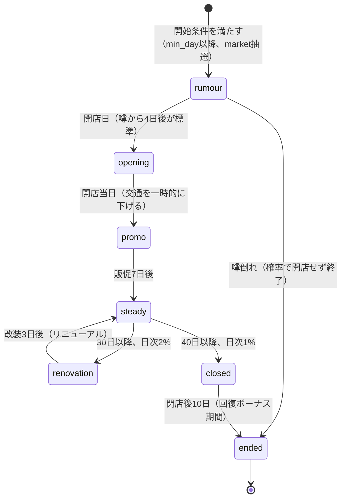
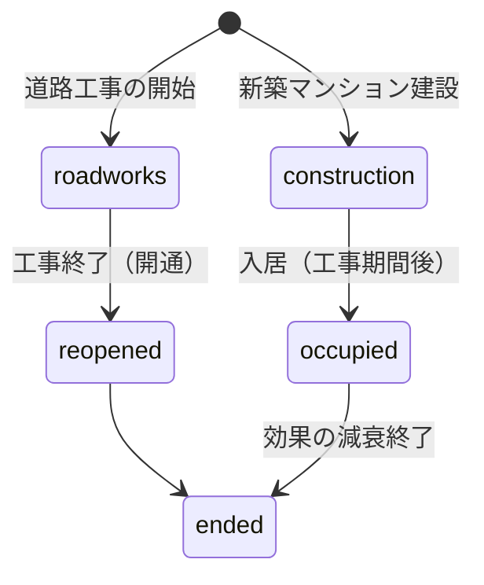

# 市場状態（ライバル出店・地域変化）設計書

対象Issue: #129（ライバルコンビニ出店・競争イベント・商圏変動）
関連: #31（日替わりイベント12件） #128（買い物かご・save v2） #135（圧縮カレンダー、未マージット） #136（販促キャンペーン） #18（広告ティア）
状態: **設計案（レビュー待ち）。コード・データ・テストは変更しない。** 数値はすべて仮説であり、実装前に調整する。

---

## 0. 結論（要約）

- 日替わりイベント（#31）は「1日単位・需要倍率のみ・1日1件」のままにする。
- 近隣の変化は **MarketCondition（市場状態）** という永続概念として別に持つ。開始日・段階（フェーズ）・終了日を持ち、日をまたいで続く。
- 需要への効果は **既存の需要式に名前付きの係数を追加する** だけにし、既存係数は書き換えない。
- すべての外部倍率（#31 + 市場状態）は合成後に **0.60〜1.50（交通）** へ丸める。市場単独の下限は **0.80** とし、初期プレイで回復不能にしない。
- 市場状態は **専用の `market` 乱数ストリーム** を使う。既存の `events` / `arrivals` / `purchases` は触らないので、既存の固定seed（345678 → `evt_after_work`）は不変。
- 保存は **schema v3** を提案（v1/v2からの移行あり）。市場データが読み込まれていない、または有効な状態がない場合、倍率は厳密に 1.0 で乱数も消費しない。
- 競争の回復はプレイヤーの行動（値付け・品揃え・レジ・販促）から、日次の **対抗ポイント（0〜4）** として決定論的に計算する。

---

## 1. 現状の確認（設計の前提）

| 項目 | 現在の実装 | 本設計での扱い |
|---|---|---|
| 日替わりイベント | `data/events/mvp_v1.json` 12件、1日1回の抽選（none重み30）。交通 0.70〜1.40、カテゴリ 1.0〜1.80 | 変更しない。`events` 乱数を1日1回消費する規則を維持 |
| 来店希望の式 | `base_potential_visitors_per_day`(50) × 時間帯重み × 広告 × 評判(0.75〜1.25) × 品揃え(0.75〜1.00) × イベント交通 / 43200 | イベント交通の隣に「外部交通（イベント×市場）」を置く |
| カテゴリ重み | 客AI `customer_ai.gd:368`：嗜好 × demand_weight × 価格係数 × イベントカテゴリ係数 | 同じ位置に市場カテゴリ係数を追加 |
| 評判 | 0〜100、開始50、1日±3まで（購買率・取りこぼし・欠品から算出） | 市場状態は評判に直接触れない（§4.4） |
| 上限 | `max_active_customers` 30。超過は `lost` に計上 | 市場による増加は「入店数の増加」ではなく「来店希望の確率」だけに作用 |
| 乱数 | `arrivals` / `purchases` / `visuals` / `events`（seed 345678） | `market` を追加（seedは別定数） |
| 保存 | `savegame` schema 2（#128）、読込可能な最古は v1 | v3 を提案（§7） |
| 時間 | 1ゲーム日 = 86400秒。60倍速で実時間 約24分 | 日数の目安はこの換算で示す |
| カレンダー | #135（1か月4日、1年48日）は `feature/m14-calendar` にあり **main未マージ** | 学校・祭りは #135 マージ後に有効化 |

注：Issueでは12件と書かれているが、データは12件、ディレクタのコメントは「13」の表記が残っている。本設計は12件として扱う（コメントの修正は別件）。

---

## 2. MarketCondition（市場状態）の概念

### 2.1 日次イベントとの違い

| 観点 | 日替わりイベント（#31） | MarketCondition（本設計） |
|---|---|---|
| 寿命 | 1日（窓は時間帯のみ） | 数日〜数週間（フェーズを持つ） |
| 抽選 | 1日1回、12件から重み抽選 | 定義（def）が開始条件を満たした日に発生。段階遷移は日次判定 |
| 効果 | 交通倍率・カテゴリ倍率 | 同じ2種だが、フェーズごとに値が変わる。プレイヤー対抗で減衰 |
| 通知 | 開始・終了の2回 | 噂・開店・終了など段階ごとに1回 |
| 同時数 | 1日1件 | 同時に最大2件（MVPは1件のライバルと1件の地域要因） |
| 乱数 | `events` | `market`（新規） |

### 2.2 フィールド（ランタイム状態）

```text
MarketCondition {
  condition_id:       "mkt:<def_id>:<start_day>"      # 冪等ID（同じ日・同じdefは1件だけ）
  def_id:             "mkt_rival_midoriya" など        # 定義の参照（data/market/*.json）
  kind:               "rival_store" | "area_state" | "cost_state"
  phase:              "rumour" | "opening" | "promo" | "steady" | "renovation" | "closed" | "ended" ...
  start_day:          int                              # 噂・工事などの開始日
  phase_start_day:    int
  next_transition_day: int | null                      # 決まっている遷移日（無ければ null）
  end_day:            int | null                       # 上限（無期限は null）
  counter_points:     int 0..4                         # 対抗ポイント（§5.3）
  last_evaluated_day: int                              # 同じ日に2回評価しない
}
```

- `phase` と `phase_start_day` から、その日の係数は **定義の表を引いて決まる** （保存しない派生値）。
- ライバル店の「店名」「業態」は定義に固定する（架空チェーン名、現実の企業名は使わない。§8）。

### 2.3 ライフサイクル規則

1. **日の境界でのみ遷移する。** 歩行中・客の途中では段階は変わらない。`day_index` の変化をトリガーにする（`EventService` と同じ位置）。
2. **1日1回の評価。** `last_evaluated_day` で二重評価を防ぐ。ロード直後や ×4 早送り、一時停止でも同じ日は一度しか進まない。
3. **開始条件。** `min_day` 以降、`market` の日次抽選（§6）が当たり、同時数の上限（ライバル1件）に空きがあれば開始。
4. **終了。** `end_day` 到達、閉店フェーズ後の日数経過、または定義の終了条件。終了後は履歴として残し、再開しない（同じ `condition_id` は二度作らない）。
5. **冪等性。**
   - 状態ID：`mkt:<def_id>:<start_day>`
   - 遷移ID：`mkt:<def_id>:<start_day>:<phase>@<day>`
   - 通知ID：`market:<condition_id>:<phase>`（既存の `daily:<day>:<event>:<phase>` と同じ形で `shown_notice_ids` に入れて重複抑止）
6. **台帳に触れない。** 市場状態は現金・在庫・価格・固定費を直接変えない（#31と同じ原則）。収益の差は客数と購買の結果としてのみ現れる。

### 2.4 定義データ（案）

`data/market/mvp_v1.json`（schema検査はイベントと同じ方式）

| フィールド | 例 | 意味 |
|---|---|---|
| `def_id` | `mkt_rival_midoriya` | 固定ID |
| `kind` | `rival_store` | 種別 |
| `name_ja` | 「ミドリ屋ストア」（架空） | 表示名 |
| `min_day` | 14（ふつう） | 開始できる最初の日（§5） |
| `phases` | `[{phase, days, traffic, categories, next}]` | フェーズ表 |
| `weight` | 1 | 同日の候補が複数あるときの重み |
| `difficulty_scale` | `{easy: 0.7, normal: 1.0, hard: 1.3}` | 効果の強さ |

---

## 3. 状態遷移図

### 3.1 ライバル店（rival_store）



| フェーズ | 期間（標準） | 交通倍率（敵対分） | 対象カテゴリ係数 | 通知 |
|---|---|---|---|---|
| rumour（噂） | 4日 | 1.00（効果なし） | 1.00 | 地域ニュース「駅前で新店の工事が始まったようです」 |
| opening（開店） | 1日 | 0.92 | snack / dessert 0.90 | 開店ニュース |
| promo（販促） | 7日 | 0.90 | snack / dessert 0.85、drink 0.95 | 「特売」ニュース（日次で1回） |
| steady（定着） | 無期限（30日以降に遷移判定） | 0.94 | snack / dessert 0.92 | なし（日次比較に表示） |
| renovation（改装） | 3日 | 1.04（ライバル休業分の追い風） | 1.00 | 「近所の店が改装中」 |
| renovation後 | 7日 | 0.90（リニューアル販促） | snack / dessert 0.88 | 「リニューアルオープン」 |
| closed（閉店） | 10日 | 1.03（回復ボーナス） | 1.00 | 「近所の店が閉店しました」 |

### 3.2 長期の地域状態（area_state）



| 状態 | 期間 | 効果（標準） |
|---|---|---|
| 新築マンション・建設 | 14日 | 交通 0.97（昼のみ 9〜14時） |
| 新築マンション・入居 | 30日 | 交通 1.06（夕方 17〜22時）、rice_ball / bread 1.08 |
| 道路工事・工事中 | 21日 | 交通 0.88（日中 9〜15時）。`evt_roadworks`（日替わり）と重なる |
| 道路工事・開通 | 7日 | 交通 1.05（全日）、通過客の増加 |
| 学校行事・学期中 | 日付規則（#135） | 平日朝 7〜8時 1.08、夕方 15〜17時 1.05 |
| 学校行事・休暇 | 日付規則（#135） | 平日朝 0.96 |
| 祭り週 | 7日（#135の週単位） | 夕方 1.12、snack / drink 1.15。`evt_local_fair` と重なる |

### 3.3 コスト面の状態（cost_state）：原材料高騰

| 状態 | 期間 | 効果 |
|---|---|---|
| 高騰 | 10日 | **仕入れ単価の提示** が対象カテゴリで 1.15 倍。既存在庫の原価は変えない（FIFO） |
| 落ち着き | — | 元の単価へ戻る |

- 需要には効かせない（価格を直接改変しない原則）。プレイヤーの判断は「仕入れを減らす」「売価を見直す」「品揃えを変える」になる。
- 既存の発注・会計の式（原価 = 仕入れ単価 × 数量）は変えない。新しい単価は **発注時** に適用。

---

## 4. 効果の合成

### 4.1 適用順（1ステップの来店確率）

既存の式に 2 つの名前付き係数を入れる。順序は固定（ソートしたID順に掛ける）。

```text
p_step = clamp( base_visits
              × hour_weight[h]
              × campaign_or_ad_mult                 # #18 広告 / #136 キャンペーン（同じ枠。二重掛けしない）
              × reputation_mult                      # 0.75〜1.25（既存）
              × assortment_mult                      # 0.75〜1.00（既存）
              × external_traffic                     # ★ clamp(E_event × E_market, 0.60, 1.50)
              / 43200, 0, 1)
```

カテゴリ重み（客AIの候補抽選）：

```text
w_sku = category_pref × demand_weight × price_factor
      × clamp(E_event_cat × E_market_cat, 0.60, 1.90)   # ★ 市場カテゴリを追加
```

- `E_event` = #31 の交通倍率（0.70〜1.40）、`E_event_cat` = #31 のカテゴリ倍率（1.0〜1.80）。
- `E_market` = 市場状態の交通倍率の積（§4.3）、`E_market_cat` = 市場のカテゴリ係数の積（§4.3）。

### 4.2 乗算か加算か

- **乗算** を採用する。既存の式がすでに乗算で、倍率を掛ける意味（「客数が 0.9 倍」）が直感と合うため。
- 加算（例：+0.1 +0.05）にすると、倍率が多いほど反応が鈍る非直感的な振る舞いになるので採らない。
- 例外：対抗ポイントによる減衰は、倍率の「敵対分（1 − m）」に対して掛ける（§5.3）。

### 4.3 市場係数の計算

各状態 *i* について、フェーズの値 *m_i*（交通）から **敵対分** を取り出し、対抗ポイント *p_i*（0〜4）で減衰させる。

```text
if m_i < 1:   m_i' = 1 − (1 − m_i) × (1 − 0.15 × p_i) × difficulty_scale   # 0.15 = 1ポイントで敵対分の15%を回復
else:         m_i' = m_i                                                    # 追い風は減衰しない
E_market      = clamp( Π_i m_i' , 0.80, 1.15 )                              # 市場全体の交通の床と天井
E_market_cat  = per category: clamp( Π_i c_i,cat' , 0.80, 1.20 )
```

- 床 **0.80**：市場の敵対分だけでは、交通が基準の 80% 未満に落ちない。
- 天井 **1.15**：追い風の重なりで、市場だけで急に客が増えない。
- 合成の床 **0.60** / 天井 **1.50**（§4.1）：#31 と市場の掛け算が極端にならないようにする安全装置。

#### 数値の例

| 状況 | m_i | p_i | 減衰後 m_i' | 備考 |
|---|---|---|---|---|
| 開店（promo） | 0.90 | 0 | 0.900 | 対抗なし |
| 同じ、対抗ポイント4 | 0.90 | 4 | 0.960 | 敵対分 0.10 の 60% を回復 |
| 定着（steady）・対抗0 | 0.94 | 0 | 0.940 | |
| 定着・対抗4 | 0.94 | 4 | 0.976 | |

### 4.4 評判には触れない

- ライバル店は **評判（reputation）に直接影響しない**。評判は既存の購買率・取りこぼし・欠品から決まるので、競争の結果は評判に既に反映される。
- 直接変えると二重計上になり、評判の ±3/日の上限も意味を失う。

### 4.5 日替わりイベントとの二重計上防止

| 重なり | 扱い |
|---|---|
| `evt_roadworks`（日替わり、9〜14時）× 道路工事（市場） | 両方を適用するが、外部交通の合成clampで 0.60 が床。日替わりの抽選は変えない |
| `evt_local_fair`（日替わり）× 祭り週（市場） | 同上。祭り週の夕方係数と、日替わりの夕方係数の積が 1.50 を超えないよう clamp |
| `evt_neighbor_mentions`（評判 60 以上で 1.25） | 市場の効果と独立に評価。評判を通した間接効果は既存の式に一致 |
| 広告（#18）× キャンペーン（#136） | 同じ枠（`campaign_or_ad_mult`）。両方を積まない（decision 3） |

- **抑制の仕組み**：日替わりの抽選を、市場状態の有無で変えない（`events` 乱数の消費は従来どおり）。重なりは clamp だけで止める。
- 「同時に出現する市場の新規開始は1日1件まで」とし、日替わりイベントと同じ日に出てもよい（通知の場所は分ける）。

### 4.6 分析用の期待値（表示のみ）

- 「ライバル店に取られた客」= 期待来店希望（外部交通 1.0 と仮定）− 実際の来店希望 — を **日次比較の説明** として表示する。
- これは **抽選を追加しない** 計算結果。実際の客数は変えない。

---

## 5. 競争の回復（プレイヤーの対抗）

### 5.1 対抗ポイント（0〜4）

日の境界で評価する（前日の結果を見る）。同じ行動を何度もしても、1要素あたり最大1点。

| 要素 | 条件（前日） | 点 | 関連する既存機能 |
|---|---|---|---|
| 値付け | 相手の強いカテゴリ（snack / dessert）の平均価格係数 ≥ 1.00 | +1 | 価格（既存の価格係数） |
| 品揃え | 在庫のあるカテゴリ数 ≥ 7（8中） | +1 | 品揃え（既存） |
| レジ | 取りこぼし率（列を離れた客 / 入店）< 2% | +1 | 会計・レジ（#128のかご） |
| 販促 | #136 のキャンペーンで対象カテゴリを扱うものが実施中 | +1 | #136（未実装なら0） |

- 対抗ポイントは **プレイヤーの行動の結果** だけで決まり、乱数を使わない。
- 点数の表示は UI の「対抗のヒント」に出す（§9）。

### 5.2 回復の速さ

- 対抗ポイントは **即時に** 効く（その日の翌日評価から）。
- 敵対分の回復上限は 60%（4点）。残り 40% は続く。ライバル店が消えるまで完全には消えない。
- 対抗ポイントを失っても、市場の係数は急に戻さず **1日ごとに 1ポイント分ずつ** 減衰させる（急な変化を避けるため）。

### 5.3 回復不能にしない仕組み

| 仕組み | 値 | 目的 |
|---|---|---|
| 市場単独の床 | 0.80 | 客数が基準の 80% 未満にならない |
| 対抗による回復 | 最大 60%（4点） | 行動で取り返せる |
| 合成の床 | 0.60 | 日替わりの低い値と重なっても極端にならない |
| 初期の保護 | min_day（§6） | 最初の数週間はライバルなし |
| 閉店 | 確率あり | 圧迫が永続しない |
| 無リスクの回復策 | 値付けと品揃えは **費用なし** | 資金が少ない状態でも取り返せる |

---

## 6. オンボーディングと難易度

### 6.1 開始の遅延（DAY 1 〜）

| 種類 | 最初の日（ふつう） | 噂の予告 | 理由 |
|---|---|---|---|
| ライバル店 | 噂 day 14、開店 day 18 以降 | 噂から 4 日 | 最初の 2〜3 週間（約 14 日 ≈ 5.6 時間の実時間）は基本操作に集中 |
| 新築マンション | day 10 以降（建設開始） | 前日の地域ニュース | 最初の方は効果が上向きで、負けを感じにくい |
| 道路工事 | day 8 以降 | 2 日前 | 日替わりの工事と重なり得るので早めに出す |
| 原材料高騰 | day 20 以降 | 1 日前 | 仕入れを学んだ後に出す |
| 学校・祭り | #135 マージ後、カレンダーで決める | 1 週間前 | 季節の情報として見せる |

- 数値は **仮説**。実時間換算：1日 ≈ 24 分（60倍速）。day 14 ≈ 5.6 時間、day 18 ≈ 7.2 時間。

### 6.2 予告の規則

- 開店・工事など **大きな変化は、発生の 2 日以上前に噂** として出す（噂フェーズを必ず置く）。
- 噂フェーズでは効果は 1.00（効果なし）。プレイヤーの準備時間として使う。

### 6.3 難易度設定

| 設定 | 最初の日 | 効果の強さ（difficulty_scale） | 頻度 | 噂の日数 |
|---|---|---|---|---|
| やさしい | 開店 day 30 以降 | 0.70 | ライバル 1 件まで、3か月に 1 回 | 6 日 |
| ふつう | 開店 day 18 以降 | 1.00 | 標準 | 4 日 |
| むずかしい | 開店 day 12 以降 | 1.30（床 0.80は不変） | 2 件まで | 3 日 |

- 難易度は **乱数の種類を変えない**。効果の強さと抽選の日付だけが変わる（同じ seed でも、難易度を変えると結果は変わるが、再現性は保つ）。

---

## 7. 保存・ロード・決定論

### 7.1 乱数

| ストリーム | 既定 seed | 用途 | 消費規則 |
|---|---|---|---|
| `arrivals` | 1234 | 来店 | 既存のまま |
| `purchases` | 5678 | 購買 | 既存のまま |
| `visuals` | 9012 | 演出 | 既存のまま |
| `events` | 345678 | 日替わり | 既存のまま（1日1回） |
| **`market`（新規）** | **456789（仮）** | 市場の抽選 | **市場データが読み込まれている場合のみ、1日1回** |

- 市場データがない、または読み込めない場合：`market` を消費しない。既存テストと既存セーブは完全に同じ結果。
- `market` を追加しても既存の4ストリームの値は変わらない。

### 7.2 セーブ schema v3（提案）

```text
savegame v3 (追加) {
  "market_state": {
    "schema_version": 1,
    "conditions": [ MarketCondition... ],    # 終了分も含めて保存（再開しない記録）
    "last_evaluated_day": int
  },
  "rng_states": { ..., "market": int }        # 新しいストリーム
}
```

| 移行 | 処理 |
|---|---|
| v1 → v3 | `market_state` を空、`rng_states.market` を既定 seed で補う。`applied_event_ids` 等は変えない |
| v2 → v3 | 同上（#128 の basket 状態はそのまま） |
| v3 → v3 | 読み込みで欠けた `market_state` は空として扱う（後方互換のため欠落を許す） |

- 旧版（v2）の保存を読んで v3 に上げる場合、**いったん保存するまでは旧版と同じ数値** になることをテストする。
- `OLDEST_LOADABLE_VERSION` は 1 のまま。
- 代替案（decision 4）：schema を上げず `runtime_state` の任意キーに入れる。移行は不要だが、市場状態の検証が弱くなる。

### 7.3 決定論の規則

1. 状態の遷移は **日の境界** で、ソートされた `condition_id` の順に 1 回ずつ処理。
2. 係数の積は **定義の順（def_id のソート順）** で掛ける。浮動小数の順序を固定する。
3. 同じ日に 2 回評価しない（`last_evaluated_day`）。
4. 一時停止・×4 早送り・ロード直後は、同じ日の結果が同一になることをテストする。
5. 市場の計算は **副作用なし**（pure function）。UI の表示用の値は、状態からその場で導出する。

---

## 8. 架空の名前とアセット（著作権）

- 店名は架空（例：「ミドリ屋ストア」「スマイルマート」「ホシノ市場」）。既存の実在チェーン名・ロゴ・配色は使わない。
- 商標・既存のチェーン名との衝突は #29 の権利監査で確認する（候補名は採用前に検索）。
- Codex（アート）に依頼するのは **任意**：遠景の看板（ライバル店）と、建物の差分（工事中の囲い・完成）。店内・客の追加は不要。

---

## 9. UI（落ち着いた表示）

### 9.1 流れ

```text
地域ニュースカード（前日の終わり・日次サマリに表示）
  → 影響カード（推定来店の変化、対象カテゴリ、期間の残り）
  → 対策ボタン（値付け・品揃え・レジ・販促の画面へ）
  → 日次比較（前日 / 本日：来店希望・入店・取りこぼし・購買）
```

### 9.2 各カード

| カード | 表示 | 例 |
|---|---|---|
| 地域ニュース | 見出し1行、本文2行、発生日 | 「駅前に新しいコンビニの工事が始まったようです」 |
| 影響 | 推定来店の変化（％）、対象カテゴリ、残日数 | 「来店の見込み −6%（スナック・デザート中心）／残り 6 日」 |
| 対策 | 3つまで。どれも費用なしで効くものを先頭に | 「スナックの値付けを見直す」「デザートの品揃えを確認」 |
| 日次比較 | 前日と本日の来店希望・入店・取りこぼし | 「取りこぼし 3 → 1 人、対抗ポイント 2 → 3」 |

- 「推定シェア」は **表示用の見積もり**（`potential / (potential + 外部交通で推定した相手の分)`）。実際の売上の断定ではないと明記する。
- 「対抗のヒント」は 4 要素（§5.1）の達成状況をチェックリストで示す。

### 9.3 落ち着いた画面の規則

- ライバルは **来店希望の確率** にだけ作用する。顧客を突然多く spawn しない。入店は `max_active_customers`（30）と既存の列制約のまま。
- 増加側の市場効果は、`max_active_customers` の上限を超えて客を入れない（超過は既存どおり `lost`）。
- 店内の見た目の変化は、遠景の看板と建物差分のみ。客の数を増やす演出はしない。
- 通知は 1 日 1 件まで（市場ニュース）。噂の日数は画面に残る（日次サマリの履歴）。

---

## 10. テストと検証

### 10.1 単体（pure）

| テスト | 合格条件 |
|---|---|
| 市場データなし | 全係数が厳密に 1.0、`market` 乱数が消費されない |
| 状態なし（データはあるが有効な状態がない） | 同上 |
| 合成clamp | E_event × E_market が 0.60〜1.50 に収まる（境界値を含む） |
| 市場床・天井 | E_market が 0.80〜1.15 |
| 対抗ポイント減衰 | 表 §4.3 の値と一致 |
| 遷移表 | 各フェーズの期間・次の遷移が表どおり |
| 冪等性 | 同じ日に 2 回評価しても結果が変わらない |
| 通知の重複 | 同じ通知IDは 1 回だけ |

### 10.2 決定論・保存

| テスト | 合格条件 |
|---|---|
| 既存の固定seed | `evt_after_work`（seed 345678）が変わらない |
| 同じ seed | 同じ条件遷移・通知順序 |
| 途中保存・ロード | 保存 → ロード後の 10 日間が、連続実行と一致 |
| v1 / v2 → v3 | 移行直後の数値が旧版と同じ（市場の効果は 0 で開始） |
| 一時停止・×4 | 同じ日の結果が同じ |

### 10.3 シナリオ（固定seed）

§11 の 5 シナリオを固定 seed で走らせ、日次の指標（来店希望・入店・取りこぼし・購買・評判）を記録する。

### 10.4 バランス確認

- 基準 50 人/日（`base_potential_visitors_per_day`）で、ライバル影響は約 −4 人/日（0.92 のとき）。
- 「3 週間で売上が 20% 以上落ちない」「対抗 4 点で、回復率 50% 以上」を受け入れ基準の仮値とする。

---

## 11. サンプルシナリオ（5件、数値は仮説）

数値は「市場の係数」（外部交通の市場分）。日はライバル開店日 D を基準にした相対日、または絶対日（ふつう、D = 18 の例）。

### S1：ライバル開店（標準の流れ）

| 日 | フェーズ | 市場交通 | 対抗ポイント | 状況・プレイヤーの行動 |
|---|---|---|---|---|
| 14 | 噂（D−4） | 1.00 | 0 | 「駅前で新店の工事」。値付けや品揃えを確認 |
| 18 | 開店 | 0.92 | 0→1 | スナック・デザートが少し減る。値付けを見直す（+1） |
| 19〜24 | 販促 | 0.90 | 1→3 | レジの列を短くする（+1）。日次比較で取りこぼし減少を確認 |
| 25 | 定着 | 0.94 | 3 | 品揃えを 7 カテゴリに（+1 → 4） |
| 25〜 | 定着 | 0.94→0.976 | 4 | 敵対分の 60% 回復。以降は緩やかに推移 |

- 回復の例：対抗 4 点のとき、交通は 0.94 から 0.976 へ。売上の差は 2〜3% 程度に縮む（仮）。

### S2：噂倒れ、後に閉店（追い風の例）

| 日 | フェーズ | 市場交通 | 状況 |
|---|---|---|---|
| 14 | 噂 | 1.00 | 「新店の工事」の噂。 |
| 18 | 噂倒れ（確率で開店せず終了） | 1.00 | 開店しない。プレイヤーの準備が無駄にならない（通知で「予定は取りやめ」） |
| 別の run の例：開店 18 → 定着 → 閉店 day 60 | closed | 1.03（10日） | 閉店後の 10 日は追い風。売上の回復を確認 |

- ポイント：噂のまま終わる場合も、プレイヤーの損失はない（効果 0）。

### S3：道路工事（長期）と開通

| 日 | 状態 | 市場交通 | 日替わり（#31）との重なり |
|---|---|---|---|
| 8 | 工事中 | 0.88（9〜15時） | `evt_roadworks` と同日なら合成 clamp で床 0.60 |
| 8〜28 | 工事中 | 0.88 | 日中の客が減る。夕方の客は影響なし |
| 29〜35 | 開通 | 1.05（全日） | 通過客の増加。`evt_quiet_street` と同日なら、1.05 × 0.85 = 0.89 |
| 36〜 | 終了 | 1.00 | 元に戻る |

- プレイヤーの行動：夕方の客に向けた品揃え（弁当・デザート）の補充。開通後の追い風を取り切る。

### S4：新築マンションの入居（追い風・品揃え）

| 日 | 状態 | 市場交通 | 市場カテゴリ |
|---|---|---|---|
| 10〜23 | 建設 | 0.97（昼のみ） | 1.00 |
| 24〜53 | 入居 | 1.06（夕方 17〜22時） | rice_ball / bread 1.08 |
| 54〜 | 終了 | 1.00 | 1.00 |

- プレイヤーの行動：夕方の売場（おにぎり・パン）の在庫を増やす。品揃えの欠品で取りこぼさない。
- 追い風の天井は 1.15。入居期間中は、既存の上限（30 人）に当たりやすくなるので、レジの速さが重要になる（#128 の basket と合わせて確認）。

### S5：原材料高騰と祭り週（重なり、clamp の検証）

| 日 | 状態 | 市場 | 日替わり（#31） | 合成（外部交通） |
|---|---|---|---|---|
| 20〜29 | 高騰（仕入れ単価 ×1.15、対象カテゴリ：drink / bread） | 1.00（需要は不変） | 通常 | 1.00 |
| 30〜36 | 祭り週（夕方 1.12、snack / drink 1.15） | 1.12 | `evt_local_fair`（夕方 1.35）が同日 | 1.35 × 1.12 = 1.51 → **1.50** に丸め |
| 37〜 | 祭り週終了 | 1.00 | 通常 | 1.00 |

- 検証：合成が 1.50 を超えないこと、高騰の間に売価を変えなければ粗利が一時的に減ること（需要は変わらない）。
- プレイヤーの行動：仕入れ量を減らす、対象の売価を見直す。祭りの夕方に在庫を切らさない。

---

## 12. 実装計画（PR 単位）

依存：#128（merged）、#135（未マージ、学校・祭りに必要）、#136（キャンペーン枠、未実装なら係数 1.0 で置く）。

| PR | 内容 | 検証 | 依存 |
|---|---|---|---|
| PR1 | `data/market/mvp_v1.json` と schema、検査関数（データのみ、シミュレーション変更なし） | 単体：schema・ID重複 | なし |
| PR2 | `MarketConditionDirector`（pure）：状態遷移、冪等ID、係数計算（§4.3） | 単体（§10.1）全項目 | PR1 |
| PR3 | 需要式に `external_traffic` と `market_cat` を追加（既存は変えない） | 市場なしでビット一致、clamp 境界 | PR2 |
| PR4 | save v3、`market_state`、`rng_states.market`、v1/v2 移行 | 途中保存・移行、既存 seed の不変 | PR3 |
| PR5 | `MarketService`（日の境界で評価、通知の発行、対抗ポイント） | 日次の遷移、×4・一時停止・ロード | PR4 |
| PR6 | UI：地域ニュース・影響・対策・日次比較（シーン） | シーンテスト、画面の落ち着き（増える客なし） | PR5 |
| PR7 | シナリオ S1〜S5 の固定seed検証、バランス表、任意：遠景看板のアート（Codex） | §10.3・§10.4 | PR6 |

- 各PRは既存テストが通ること（特に固定seed `evt_after_work`）を前提に、差分を小さく保つ。
- PR1〜PR3 は **ゲームの挙動を変えない**（市場データなし）。ここで既存の仕様を壊していないことを先に示す。

---

## 13. 非対象（今回の設計に含めないもの）

- 競合店の店内を丸ごとシミュレーションすること（客・在庫・レジを持つ別店舗）。
- 実在のチェーン・ブランド・ロゴの使用。
- 広告媒体の詳細（#136 で設計）。ここでは「キャンペーン枠」を 1 か所用意するだけ。
- 評判を市場から直接動かすこと（§4.4）。
- 価格・固定費・既存の在庫原価を、市場状態で直接変えること（コスト面は発注時の単価のみ）。
- 既存の12件の日替わりイベントの定義・seed・保存の変更。

---

## 14. 決めてほしいこと（ユーザーレビュー）

1. **合成の範囲**：外部交通 0.60〜1.50、市場単独の床 0.80・天井 1.15 で良いか（余裕を広げるなら床を 0.70 に）。
2. **最初のライバルの日と難易度**：ふつうは開店 day 18（約 7 時間）で良いか。難易度 3 段階（やさしい / ふつう / むずかしい）で良いか。
3. **広告ティアとキャンペーンの関係（#136）**：現行の広告ティア（最大 1.40）を媒体キャンペーンに置き換えるか、併存させて一つの枠で合成するか。二重掛けは禁止（§4.1）。
4. **保存の方式**：schema v3 を上げて `market_state` を正式に持つか（推奨）、`runtime_state` に入れて当面は schema を上げないか。
5. **視覚の範囲**：遠景の看板（任意アート）だけにするか、ミニマップの表示まで入れるか。

---

## 15. 関連ファイル（設計の根拠）

- `scripts/domain/gameplay_event_director.gd`（日替わりの抽選・窓・効果）
- `scripts/application/event_service.gd`（日の境界の処理、通知ID）
- `scripts/domain/demand_model.gd`（来店確率の式）
- `scripts/application/demand_generator.gd`（来店の抽選、`arrivals`）
- `scripts/application/customer_ai.gd`（カテゴリ重み、L368）
- `scripts/domain/reputation_model.gd`（評判の更新、±3/日）
- `scripts/domain/basket_model.gd`（#128 のかご）
- `scripts/application/save_game.gd`（schema 2、移行）
- `data/events/mvp_v1.json`、`data/balance/mvp_v1.json`
- `docs/implementation/13_EVENT_DIRECTOR_AND_GAMEPLAY_EVENTS.md`（倍率の範囲、二重計上の禁止）
