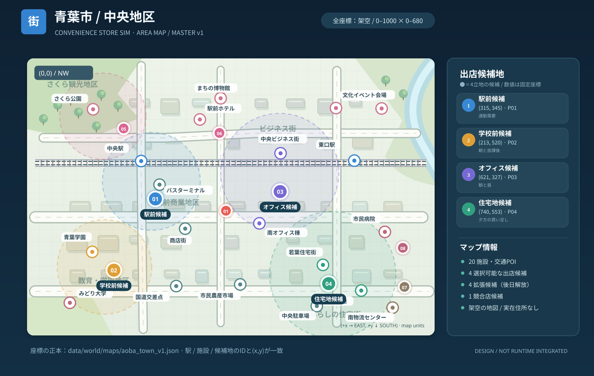

# 青葉市・中央地区：架空都市マップ v1

- **座標正本**: [data/world/maps/aoba_town_v1.json](../../../data/world/maps/aoba_town_v1.json)
- **マップ画像**: `docs/design/maps/aoba_town_map_v1.svg` (1800x1140)
- 施設(POI)20か所、出店区画8件、ライバル区画1件。駅、学校、ホテル、住宅地、物流、観光地を設定。
- x∈[0,1000], y∈[0,680]。原点は左上、右が東、下が南、単位map_unitで、実際の距離/緯度経度ではない。
- SVGの地図領域は (x=82, y=177), scale=1.235 なので、`(svg_x,svg_y)=(82+1.235*x,177+1.235*y)`。
- **アートと座標のみ**: Godotでのクリック/ズーム/商圏計算・実シミュレーション連携は未実装。画像に印刷した地名を固定UIとせず、Godot独立レイヤーにピンとtooltipを実装。
- #150 (地域マップ)、#148 (立地)、#146 (複数店舗)、#149 (客層)、#151 (観光客)、#129 (ライバル) と接続。
- このマップは`map_id=aoba_town_v1`。別マップとなる「神戸・淡路エリア」は別のIDとデータで管理し、座標を共有しない。
- 多言語POPは制作しない。