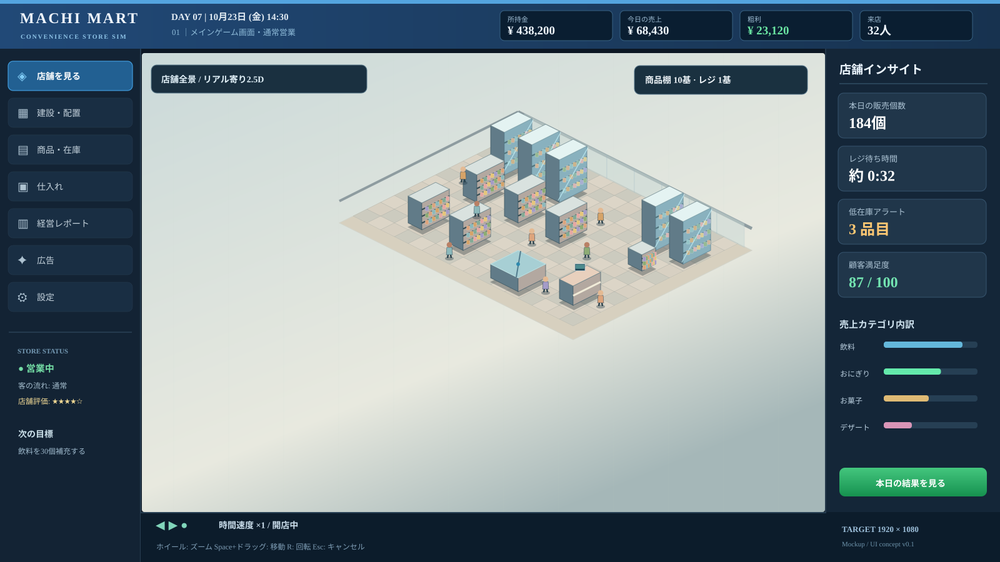
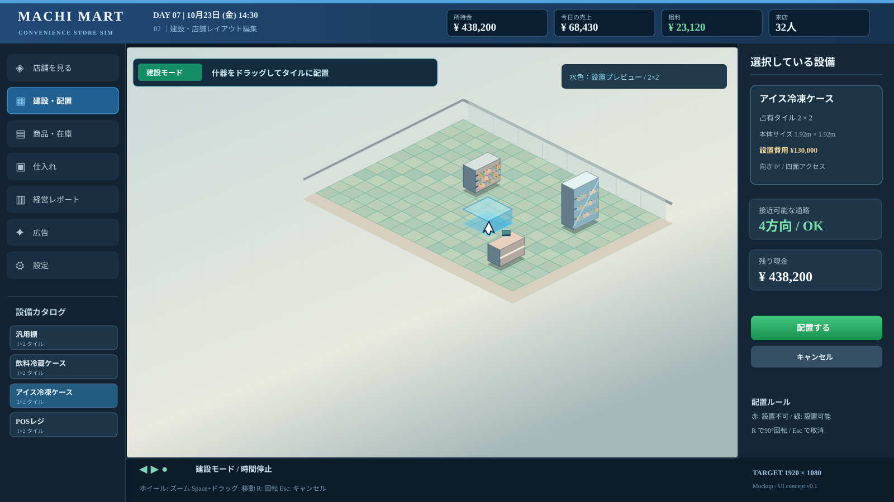
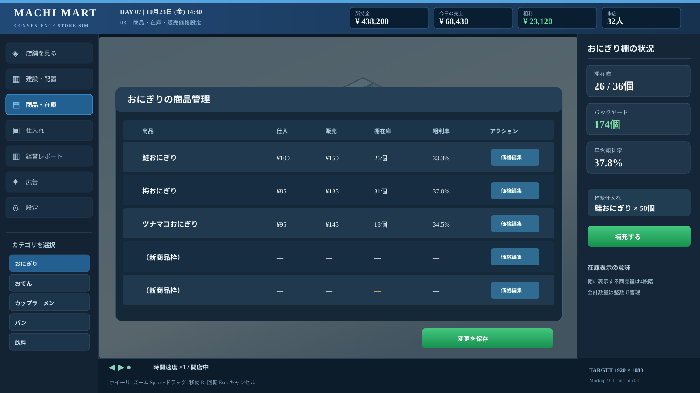
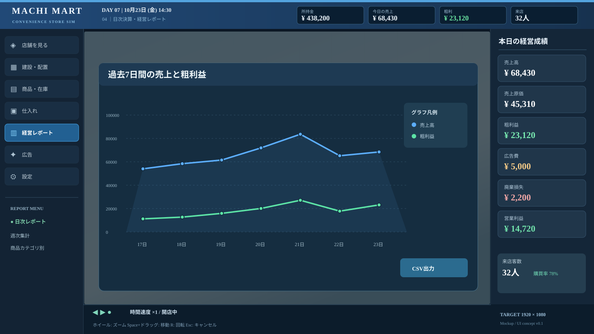

# 目標ゲーム画面 — 2.5Dアイソメトリック・UIモックアップ

作成日: 2026-10-23 / 画風: リアル寄り2.5D、清潔感のある日本のコンビニ、固定カメラ。

|画面|プレビュー|主な機能|実装Issue|
|---|---|---|---|
|通常営業||コンビニ全景、HUD、客、棚、売上|#5, #15, #21, #23|
|レイアウト編集||16×12床グリッド、什器カタログ、ゴースト配置、回転、右インスペクタ|#6, #7, #8, #21|
|商品・在庫管理||カテゴリ、仕入原価、販売価格、棚在庫、商品編集|#10, #11, #12, #21|
|日次経営レポート||売上・粗利益の推移、広告・廃棄・費用の比較|#17, #19, #21|

## 目的と精度
- このディレクトリの4枚は**Gitに登録した個別SVG画像**。編集・レビュー用の概念UIデザインであり、Godotにそのまま配置する実ゲーム素材や完成画面ではない。
- 画面内の金額、SKU追加予定欄、建設時の残高、家具の見た目/位置は**画面表現の例**。実装のマスタ商品24種類やモデルサイズの契約を上書きしない。
- 演出用のアイソメトリック床タイルはSVG内では見やすい小縮尺で描いている。**ゲーム内の実タイルは1m×1m、zoom1で128×64px**。Blender等の制作寸法は[実装規格02](../../implementation/02_GRID_AND_ASSET_CONTRACT.md)を正とする。
- メインビューに2.5D什器・客を表示し、左に機能/建設、右に選択情報、上に主要経営指標、下に時間速度を置く。
- 実装では1920×1080を標準。これらのSVGは**1600×900の構図参考**であり、実画面への実寸変換時にはHUD64px、左280px、右320px等の[04_UI_SAVE_QA_CONTRACT](../../implementation/04_UI_SAVE_QA_CONTRACT.md)を使用する。
- 店舗を建設できるのは`business_state=SETUP`。営業中の単純pauseでは設置/撤去を許可しない。
- 什器1×2の客アクセス面は**Eの2m長辺**をデータから計算し、90°回転でS側へ。画像で見える面の印象よりDomain定義を優先。
- 在庫パネルでは「棚在庫」と「バックヤード在庫」、「仕入れ価格」と「販売価格」を分ける。帳簿の金額はすべて整数円。
- 日次レポートでは売上、COGS、粗利、広告、廃棄、固定費、営業損益、現金残高を**別々に表示**する。グラフは展示用仮データ。

## 実装者への推奨順序
1. 空店舗16×12を、店舗全景スクリーンの中心に表示し、正しいタイル投影を実装 (#4/#5)。
2. レイアウト編集スクリーンを、論理占有と売場への経路の上に実装 (#6/#7/#21)。
3. 基準3種（レジ/汎用棚/冷蔵庫）の実アセットと照明を統一し、SVGの簡易ブロックをスプライトへ差替 (#8/#9/#26)。
4. 商品・在庫UIを実SKU/StockLotの読み取り専用snapshotにつなぐ (#10/#11/#21)。
5. 日次会計をゴールデンテストで検証した後、レポートへ表示 (#17/#19)。

**アセット制作実績:** この時点でゲーム本体の3D什器、2Dスプライト、実商品の商品パッケージは未生成。SVGはUIのデザイン基準に限る。

関連: [ディレクトリ設計](../PROJECT_DIRECTORY_STRUCTURE.md)、[ゲーム仕様](../../GAME_DESIGN_SPEC.md)。
