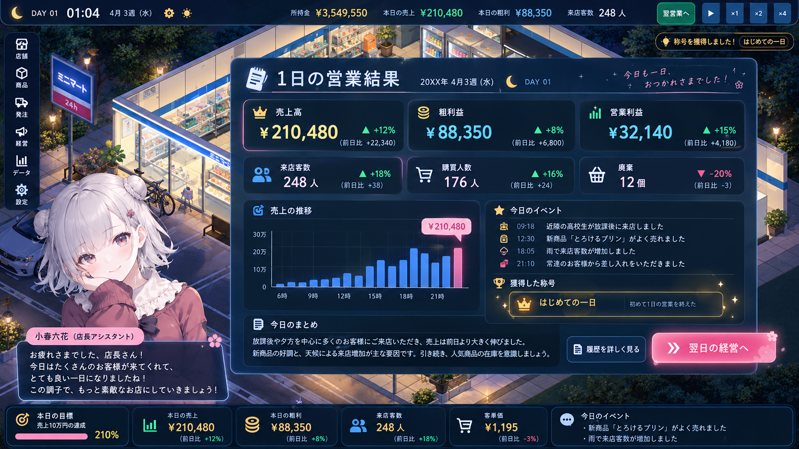

# 小春六花 — 1日の営業結果 UI 改善モックアップ（2026-10-31）

## 目的
現在の「営業終了→1日の営業結果」フローを基に、売上・利益・来店状況と小春六花の振り返りが一目で分かる画面デザインを検討するための **参考モックアップ** です。

## ファイル
- `day_end_results_rikka.png` — 1672 × 941 px、オリジナルPNG。画面全体で独立した1枚のUI。
- 作成日：2026-10-31、ChatGPTで生成したデザイン案。

## デザイン意図
- 日次売上、粗利益、営業利益、来店客、購入客、廃棄を分かりやすく整理。
- 時間帯別売上、当日のイベント、獲得した称号を集約。
- 小春六花の1日の振り返りコメントを、画面左下の立ち絵と組み合わせる。
- 「履歴を詳しく見る」と「翌日の経営へ」を分かりやすく配置。
- 閉店時の店舗シーンを背景に残し、ゲーム世界とのつながりを維持。

## 実装前に確認する点
- **すべての金額・人数・日付・グラフ・イベントは仮データ**。現行ゲームの実際の値や保存仕様と一致することを保証しない。
- 実ゲームでは「DAY 0」等の表示もあるため、日付・集計タイミング・実績称号との整合を再検討する。
- 小春六花の実装済み立ち絵、テキスト量、ウィンドウのサイズに合わせてレイアウトを調整する。
- 今回は**画像の登録のみ**。ゲームコード、既存アセット、動作ロジックは変更しない。

## 参考
- 既存の「1日の営業結果」Draft PR #175 を元に、閉店後に小春六花が振り返る演出を改善するための案。
