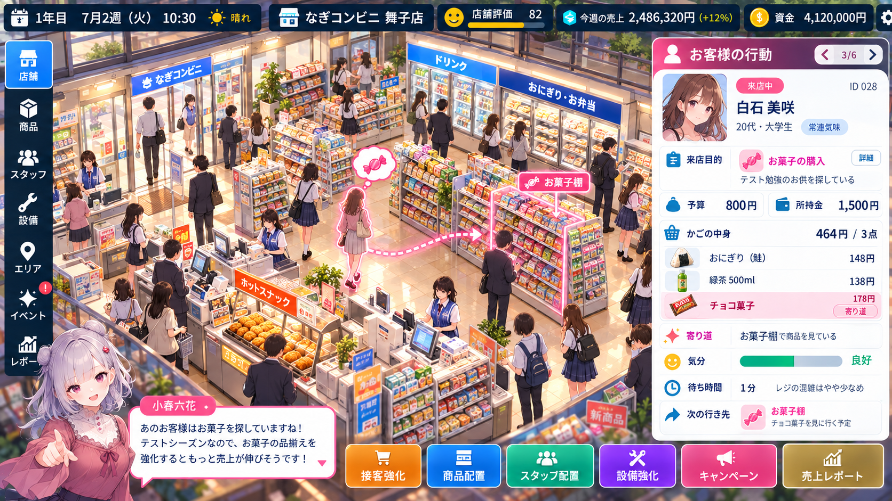
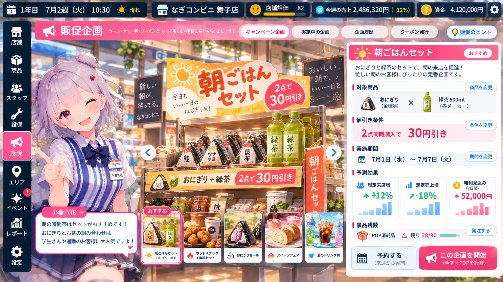
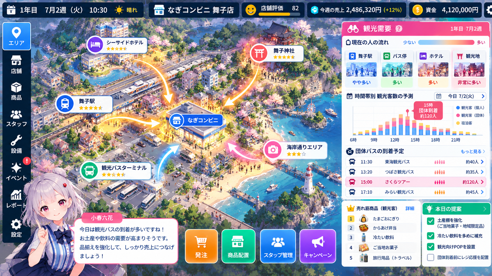

# 小春六花・ゲームらしいUIモックアップ（2026-10-31）

2026-10-31のChatGPTで作成した、コンビニ経営ゲームの**単独16:9画面**3枚のレビュー用デザイン案です。小春六花を案内役にしています。

| 画像 | 画面 | 関連Issue |
|---|---|---|
|  | [お客様の行動・寄り道買い](customer_behavior_gameplay.png)：選択客の目的、予算、かご、寄り道、次の行先を示す | [#141](https://github.com/yn217/Convenience_store_Sim/issues/141) |
|  | [朝ごはんセット販促](breakfast_bundle_promotion_gameplay.png)：おにぎりと飲料のセット割、期間、販促効果を表示 | [#137](https://github.com/yn217/Convenience_store_Sim/issues/137) |
|  | [観光需要・地域マップ](tourism_demand_map_gameplay.png)：ホテル・駅・観光施設からの需要と観光バス到着予測を表示 | [#151](https://github.com/yn217/Convenience_store_Sim/issues/151)、[#150](https://github.com/yn217/Convenience_store_Sim/issues/150) |

## 制作目的とレビュー条件
- 3枚ともそれぞれ独立した **1672×941 PNG**。複数画面をまとめたコラージュではありません。
- ゲーム世界を広く見せ、人物・店内・売場の情報に必要なUIだけを重ねるビジュアルデザインの候補です。
- **正式採用・実装・実機キャプチャではありません。** 表示数値、期間、商品名、画面表現は仮値であり、Issue本文と現行ゲーム仕様を優先してください。
- #141: 客を選択したときに詳細が表示され、停止中でも位置とパネルが一致するか、画面中の情報量が過剰でないかをレビュー。
- #137: セット割は複数SKU購入時のみ適用、実会計・販促費・在庫と整合。画像の値引き表現のみでゲーム機能が実装されたとは見なしません。
- #151: **多言語POPは作らない**。観光目的・時間帯・周辺施設に基づく需要を想定し、国籍や外見から購買行動を決めつけない。
- 小春六花等のキャラクターの利用条件・表示名・権利については公開/配布/実装前に確認してください。
- 現行の店舗外アセットは2D・非タイル連続背景方針（#111）。この画像はゲーム本体の2D/3D制作方式を変更する指示ではありません。
- このコミットでは既存のゲームコード・仕様・アセットを編集せず、新規画像と説明文のみを追加します。
