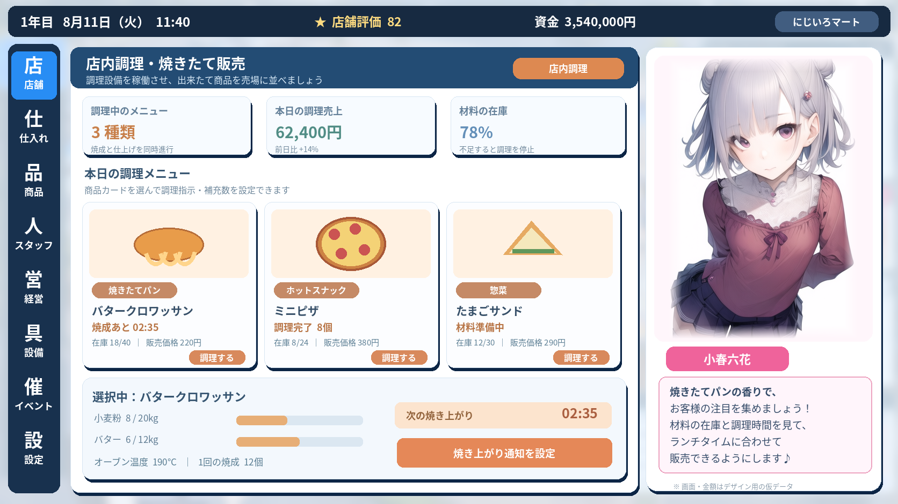
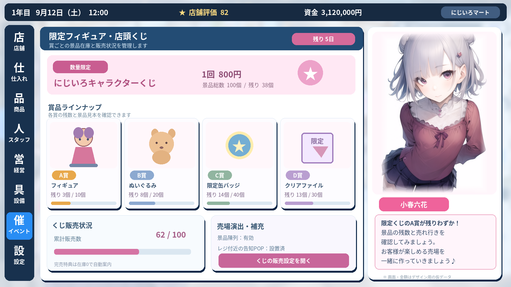
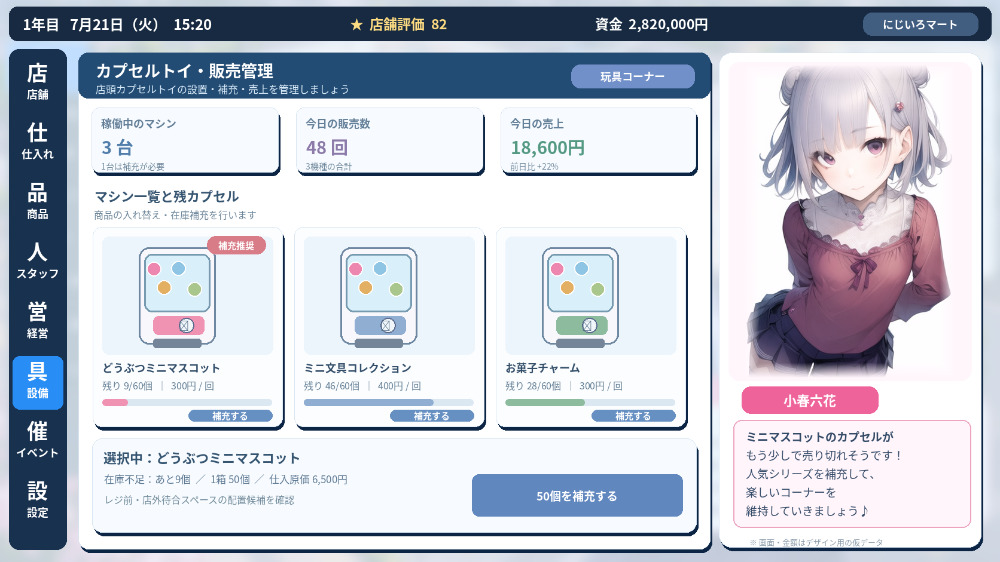

# 小春六花：新規ゲーム画面モックアップ3種（2026-10-31）

コンビニ経営ゲーム用の、**1画面 = 1 PNG** の独立した画面デザイン案です。
ゲーム本体・Godotシーン・経済ロジック・既存アセットには変更を加えていません。

| ファイル | 画面 | 関連Issue | 参考画像 |
| --- | --- | --- | --- |
| `cooking_bakery.png` | 店内調理・焼きたてパン販売 | #130 |  |
| `collectible_lottery.png` | 限定フィギュア・店頭くじ管理 | #138 |  |
| `capsule_toys.png` | カプセルトイ・販売管理 | #139 |  |

## 取り扱い

- 3点ともPNG、1672×941px（横長）。
- 小春六花を案内役として配置し、機能ごとに異なる専用UIを構成したデザインモックアップ。
- 画面中の価格、在庫数、収益効果、UI文言は**仮データ**であり、実装済み機能や確定したゲーム仕様を意味しません。
- レビュー用・デザイン検討用です。**未実装／runtime未承認**。実装に際しては対応するIssueの仕様と照合し、ゲーム画面の実機QAを実施してください。
- 生成された画像および描かれたキャラクターの商用配布・再利用に関する権利とガイドラインは、正式採用前に別途確認してください。
- 既存のモックアップ、画像、仕様の上書きは行わず、独立フォルダに保管しています。
