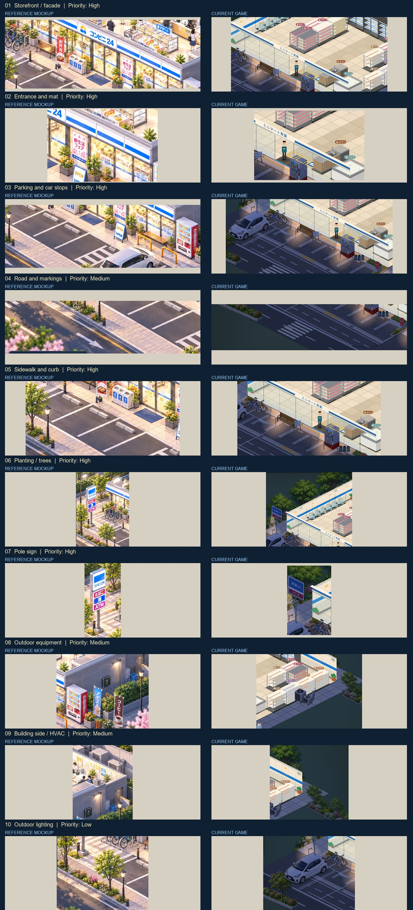

# Reference mockup gap matrix — 2026-10-28

Reference: `C:/Users/yuuna/Downloads/image-1792819026698.webp` (1672×941). Current: `store-16x12.png` (1600×900), captured from the running game with the updated exterior assets. The paired crops below use matched subject areas, not pixel-aligned camera framing.

| Region | Current state compared with the reference | Asset / placement approach | Priority |
|---|---|---|---|
| Storefront | Blue fascia and transparent full-height glazing are present. The reference has brighter interior light, stronger reflections, denser signage, and finer door framing. | Keep pane geometry aligned to world frontage; add door/frame detail and authored reflection accents without covering customers or fixtures. | High |
| Entrance | Door opening, mat, and nearby exterior props remain functional. The entrance reads more sparsely and less like a continuous glass frontage than the reference. | Continue using interactive door placement and world-aligned mat; add modular door surround and glass decal details. | High |
| Parking | Parking stalls and a parked vehicle are visible, but wheel stops, curb transitions, and surface texture are less detailed. | Build from a few reusable isometric parking/curb pieces and retain world alignment. | High |
| Road | Road edge, lane marks, and crosswalk are present. The road is darker and flatter than the sunlit target. | Improve asphalt value variation and directional markings as ground artwork; avoid baking store UI into art. | Medium |
| Sidewalk | Paving ring and curb outline the store. The reference uses lighter, finer tile joints, richer shadows, and more continuous frontage paving. | Continue projection-based ground geometry; tune color and joint density rather than enlarging tiles. | High |
| Planting | The new rear V has denser tree crowns and flower layers; the tall side strip is rooted behind the wall and spans the full edge plus overhang. The target still has broader, brighter flowerbeds and more varied tree spacing. | Keep grouped one-piece static vegetation panels with measured root anchors and uniform scaling. Broaden the side bed and refine alpha edges in a future generated pass. | High |
| Pole sign | A readable pole sign is present, but its silhouette and face are simpler and smaller than the reference sign stack. | Keep text rendered as UI/font layers; consider a wider multi-panel sign sprite on a world-ground pivot. | High |
| Outdoor equipment | Vending, bins, bench, bicycle rack, and HVAC props exist; target has more detail and better composition around the facade. | Upgrade as separate reusable props, preserving their current interaction and placement footprints. | Medium |
| Building side / HVAC | Wall panels and HVAC units are present. The target has finer seams, varied equipment housings, and more convincing night/day material response. | Add modular side-wall overlays and tune equipment sprites/shadows. | Medium |
| Outdoor lighting | Lamp pools and local lights are visible, but the target has warmer, softer natural illumination and many more contact shadows. | Improve scene lighting and contact shadows independently of vegetation and wall geometry. | Low |

## Current verification boundary

- Store size and view checks are recorded in [RESULTS.md](RESULTS.md): 12×10, 16×12, 20×16, 1280×720 at ×0.8 zoom, 1920×1080 at ×1.2 zoom, camera pan, and build preview.
- The generated rear V and side strip are static background imagery; movable store props remain separate sprites.
- The goal is still in progress. This pass specifically resolves ground-based plant anchors, wall occlusion, side-strip length, and an initial full-height glass read. It does not yet reproduce the mockup's photographic lighting, rich indoor detail, or high-density roadside composition.
